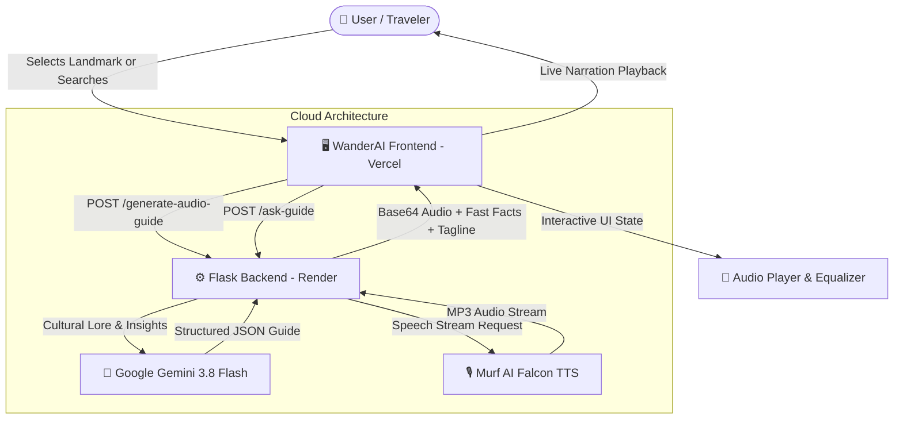

<div align="center">

# 🌍 WanderAI • Liquid Glassmorphism AI Travel Companion

### *An Intelligent, Multilingual Voice Storyteller for the Wonders of Earth*

[](https://aitarvelguidefrontend.vercel.app)
[](https://ai-tarvel-guide.onrender.com)
[](https://ai.google.dev)
[](https://murf.ai)
[](LICENSE)

<br/>

**[🌐 Visit Live Website](https://aitarvelguidefrontend.vercel.app)** • **[📡 Live Backend API](https://ai-tarvel-guide.onrender.com)** • **[📂 GitHub Repo](https://github.com/chandrakanthGupta/AI_tarvel_guide)**

<br/>

---

</div>

## 📖 Overview

**WanderAI** transforms global tourism into an interactive, sensory experience. Powered by **Google Gemini 3.8 Flash** and **Murf AI Falcon TTS**, it generates real-time multilingual voice guides, cultural secrets, traveler insights, and conversational tour guide Q&A for world monuments—wrapped in a cutting-edge **Liquid Glassmorphism** user interface.

Whether exploring pre-configured wonders or searching *any custom destination across the globe*, WanderAI delivers studio-grade spoken audio, live soundwave visualizations, and deep cultural knowledge on demand.

---

## ✨ Key Features

### 💎 1. Liquid Glassmorphism Aesthetics
* **Ambient Fluid Dynamics**: Floating organic gradient background orbs that drift smoothly behind frosted surfaces.
* **Refraction Borders & Specular Sheen**: High-depth backdrop blurs (`backdrop-blur-2xl`), liquid refraction borders, and reactive light sweeps on hover.
* **Adaptive Neon State Indicators**: Glowing interactive pills and action buttons.

### 🎙️ 2. Studio-Grade Multilingual Voice Guides
* **4 Languages Supported**: English (`en-US`), Hindi (`hi-IN`), Tamil (`ta-IN`), and Telugu (`te-IN`).
* **Narrator Personas**: Realistic Male and Female studio voices generated via Murf Falcon.
* **Dual Tour Depths**:
  * **⚡ 1-Minute Quick Summary**: High-level historical overview and key significance.
  * **📖 3-Minute Storytelling Tour**: Rich architectural lore, timeline, and cultural narratives.
* **Bulletproof Audio Fallback**: Automated fallback to browser Web Speech API ensures audio narration plays seamlessly even under network constraints.

### 🎵 3. Custom Audio Player & Live Soundwave Equalizer
* **Synchronized Waveform**: Multi-bar animated equalizer pulses in real time with audio playback.
* **Audio Controls**: Variable speed toggles (`1.0x`, `1.25x`, `1.5x`), 10-second forward/rewind, interactive progress seek bar.
* **Offline Audio Guide Download**: Direct `.mp3` download button to save audio files locally.
* **Interactive Transcript**: Collapsible story reader with one-click clipboard copy.

### 🔍 4. Universal Destination Explorer & "Surprise Me"
* **Search Any Global Destination**: Type landmarks anywhere on Earth (*e.g., Colosseum, Kyoto, Eiffel Tower, Machu Picchu*) to generate an AI-discovered card and audio guide.
* **Surprise Destination Generator**: Clicking **"Explore"** on an empty search bar acts as an instant random wonder picker.
* **Dynamic Category Filtering**: Filter between *All Places*, *Wonders*, *Forts & Palaces*, *Spiritual*, and *Architecture*.

### 💬 5. Interactive "Ask the AI Guide" Concierge
* Integrated Q&A box enabling visitors to ask arbitrary travel questions (*e.g., photography angles, nearby food, dress codes*).
* Instant contextual answers delivered by Gemini in the selected language.

---

## 🏛️ System Architecture



---

## 🛠️ Technology Stack

| Layer | Technologies & Tools |
| :--- | :--- |
| **Frontend** | HTML5, Modern ES6+ JavaScript, Tailwind CSS (CDN), Google Fonts (*Playfair Display*, *Outfit*, *Plus Jakarta Sans*) |
| **Backend** | Python 3.13, Flask 3.0, Flask-CORS, Gunicorn |
| **AI Text Engine** | Google Gemini API (`gemini-3.8-flash` with fallback to `gemini-3.5-flash-lite`) |
| **Voice Synthesis** | Murf AI Falcon Streaming API (`https://global.api.murf.ai/v1/speech/stream`) |
| **Deployment** | **Frontend**: Vercel • **Backend**: Render • **Source**: GitHub |

---

## 📡 API Reference

### 1. Generate Audio Guide
* **Endpoint**: `POST /generate-audio-guide`
* **Request Body**:
  ```json
  {
    "place": "Taj Mahal",
    "answerType": "Summary",
    "language": "English",
    "voiceId": "Matthew",
    "locale": "en-US"
  }
  ```
* **Response**:
  ```json
  {
    "description": "An immense mausoleum of white marble...",
    "audioBase64": "//uQx...",
    "tagline": "An Eternal Poem Carved in White Marble",
    "bestTime": "October to March at sunrise",
    "insiderTip": "Visit at dawn to avoid large crowds and capture soft lighting.",
    "highlights": ["Architectural symmetry", "Reflecting pool", "Calligraphic inlays"]
  }
  ```

### 2. Tour Guide Q&A
* **Endpoint**: `POST /ask-guide`
* **Request Body**:
  ```json
  {
    "place": "Taj Mahal",
    "question": "What is the best photography spot?",
    "language": "English"
  }
  ```
* **Response**:
  ```json
  {
    "answer": "The iconic angle is from the front reflecting pool along the central waterway..."
  }
  ```

---

## 🚀 Local Development Setup

### Prerequisites
* Python 3.10+
* Git
* Valid Gemini & Murf API keys

### 1. Clone the Repository
```bash
git clone https://github.com/chandrakanthGupta/AI_tarvel_guide.git
cd AI_tarvel_guide
```

### 2. Set Up Environment Variables
Create a `.env` file in the `Backend/` directory:
```env
GEMINI_API_KEY=your_gemini_api_key_here
MURF_API_KEY=your_murf_api_key_here
```

### 3. Install Backend Dependencies
```bash
cd Backend
pip install -r requirements.txt
```

### 4. Run the Backend Server
```bash
python app.py
```
*Server runs locally on `http://127.0.0.1:5000`.*

### 5. Open the Frontend
Open `Frontend/index.html` directly in any modern browser, or serve it using Live Server:
```bash
start Frontend/index.html
```

---

## 📁 Repository Structure

```
AI_tarvel_guide/
├── Backend/
│   ├── .env.example          # Environment variable template
│   ├── app.py                # Main Flask API, Gemini & Murf integration
│   ├── Procfile              # Render/Heroku deployment configuration
│   └── requirements.txt      # Python dependencies
├── Frontend/
│   ├── index.html            # Liquid Glassmorphic UI & audio console
│   └── index.js              # Client state, audio player & API handler
├── index.html                # Root mirror for static hosts
├── index.js                  # Root mirror for static hosts
└── README.md                 # Project documentation
```

---

## 👨‍💻 Author

* **Chandrakanth Gupta** — [GitHub Profile](https://github.com/chandrakanthGupta)
* **Project Repository**: [chandrakanthGupta/AI_tarvel_guide](https://github.com/chandrakanthGupta/AI_tarvel_guide)

---

<div align="center">
  <sub>Built with ❤️ using Google Gemini & Murf AI Falcon</sub>
</div>
